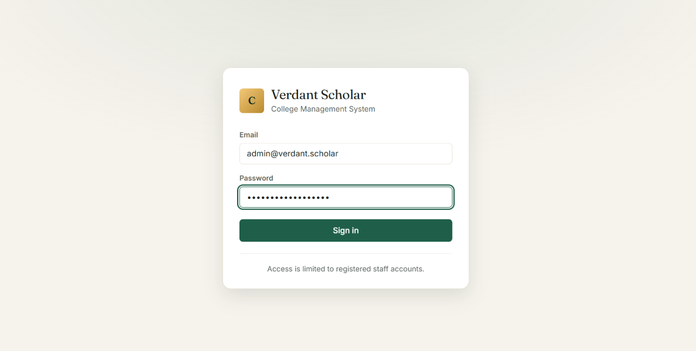
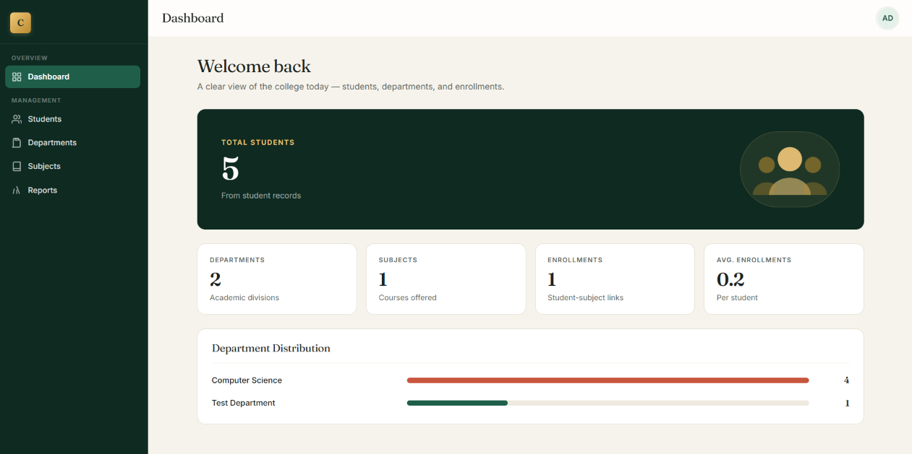
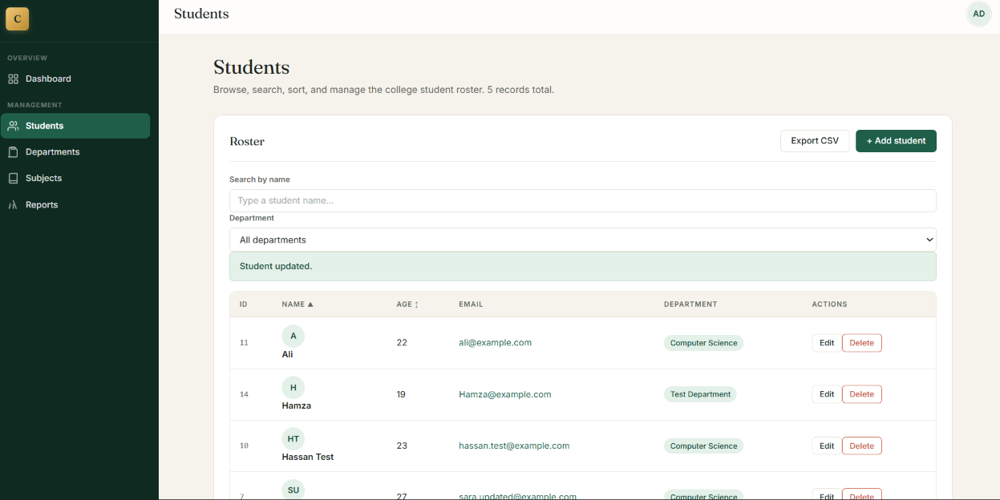
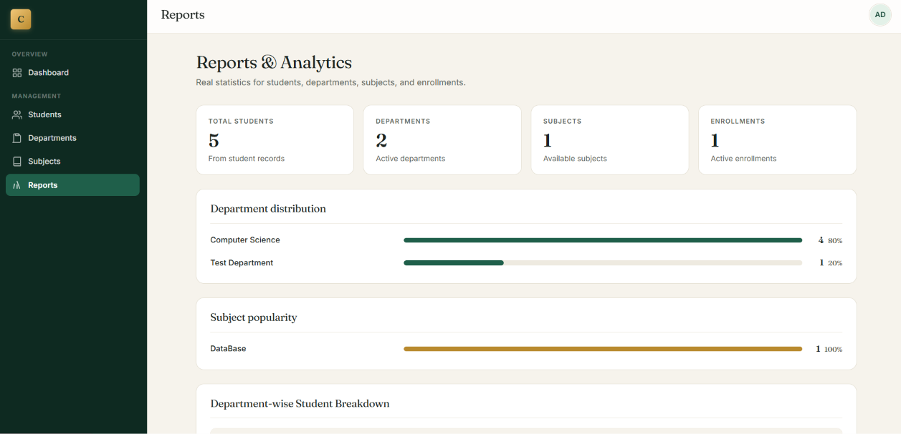

# Verdant Scholar — College Management System

A College Management System with Angular (frontend), ASP.NET Core Web API (backend), SQL Server (database), and JWT-based authentication with role-level authorization (Admin, Teacher).

## Tech Stack
- **Frontend:** Angular 22.2 (standalone components, signals, native control flow)
- **Backend:** .NET 10 Web API, ASP.NET Core Identity, EF Core SqlServer 10.0.13
- **Database:** SQL Server LocalDB (`StudentManagementDB`)
- **Auth:** JWT Bearer (HS256) with `sessionStorage`; ASP.NET Core Identity (`AppUser` int key + `AppRole` int key)
- **Design:** Anti-aliased serif/sans typography (Fraunces / Inter), brass/green palette, responsive sidebar + topbar

## Features
- Student directory with search, filter, sort, pagination, CSV export, add/edit/delete
- Department and Subject directory management
- Enrollment management (student ↔ subject links)
- Dashboard statistics (students, departments, subjects, enrollments)
- Reports and analytics (department distribution, subject popularity, correlation)
- Role-based authorization (`[Authorize]` on protected controllers); login via `POST /api/auth/login`

## Setup (self-contained repo)

All source, migrations, and the setup CLI are included.

### 1. Create the database with EF Core migrations
```powershell
# From repo root
cd StudentManagementApi
dotnet ef database update
```

### 2. Configure JWT signing key and SQL connection string
Edit `StudentManagementApi/appsettings.json` or use environment variables:
```powershell
$env:JWT__SigningKey = "YourRealSecret-32Chars-Minimum!"
# ConnectionString defaults to (localdb)\MSSQLLocalDB; edit if using a different server.
```

### 3. Create the initial admin using the setup tool
```powershell
$env:SETUP_ADMIN_PASSWORD = "YourSecurePass123!"
dotnet run --project StudentManagementApi.SetupAdmin/
```
(The CLI exits without overwriting if the Admin already exists.)

### 4. Run the backend
```powershell
cd StudentManagementApi
dotnet run --urls https://localhost:7235
```

### 5. Run the Angular frontend
```powershell
cd ..
npm install
ng serve
```

The UI calls `https://localhost:7235/api/`. The JWT is stored in `sessionStorage`; the interceptor attaches `Authorization: Bearer <token>` to all requests.

## Screenshots


*Login page — branded card with email/password fields, dark sidebar theme behind*


*Dashboard — stat cards with department distribution bars*


*Students — paginated table with filters, search, and sorting*


*Reports and analytics — department distribution and correlation views*

## Security Notes
- The JWT signing key **must** be set via the `JWT__SigningKey` environment variable or `Jwt:SigningKey` in `appsettings.json`. The default `appsettings.json` contains a placeholder — **do not use it in production**.
- The `StudentManagementApi.SetupAdmin` CLI requires `SETUP_ADMIN_PASSWORD`; no hardcoded password exists.
- No `[Authorize]` attributes were removed; login endpoint (`/api/auth/login`) remains public.
- Existing database tables and data are preserved; no migrations were altered.

## Project Layout
```
StudentManagementApi/          # Backend (.NET 10 + EF Core + Identity + JWT)
  Controllers/                 # Students, Departments, Subjects, Enrollments, Stats, Auth
  Services/                    # StudentService, TokenService
  Data/                        # ApplicationDbContext
  Migrations/                  # InitialCreate, AddDepartmentsSubjects, IdentitySetup

student-management-ui/         # Angular 22 frontend
  src/app/
    auth/                      # interceptor, guard
    services/auth.service.ts   # sessionStorage + JWT decode
    components/login/
    components/layout/         # sidebar + dropdown with sign-out

StudentManagementApi.SetupAdmin/  # One-time console tool to create first Admin
```

## License
Educational / portfolio project.
